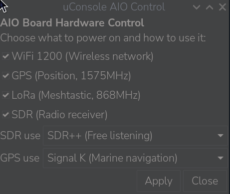

# uConsole AIO Panel

A small graphical control panel for the **HackerGadgets AIO v2 board** for the ClockworkPi uConsole: power each module on or off and pick what the SDR and GPS are used for, without touching the terminal.



## What it does

- **Powers the AIO modules** through their GPIO pins (USB ports 23, GPS 27, LoRa 16, SDR 7), with the real state read at boot too (SDR rail on by default).
- **Frees the SDR dongle for the selected mode.** An RTL-SDR can be opened by one program at a time, so the panel stops whatever the selected mode does not need:
  - **TAR**: `readsb` + `tar1090`, aircraft map in the browser.
  - **AIS**: [AIS-catcher](https://github.com/jvde-github/AIS-catcher), ship map on http://localhost:8100 and NMEA on UDP 10110.
  - **SDR++**: nothing running, the dongle is free for SDR++ or any other app.
- **Starts the GPS chain you need:**
  - **NMEA**: the module is powered, the serial port stays free.
  - **GPSD**: `gpsd` for maps, navigation and GPS apps.
  - **Signal K**: `gpsd` + [Signal K](https://signalk.org), which merges GPS and AIS for OpenCPN and nautical apps (http://localhost:3000).
- **Starts and stops Meshtastic** (`meshtasticd`) together with the LoRa module.
- Asks for your password **once** with a graphical prompt, only when sudo needs it.
- Stops each module's services **before** cutting its power.

## Related

For a tray icon, CLI commands, power telemetry, rail states at boot and RTC sync, see [hackergadgets/aiov2_ctl](https://github.com/hackergadgets/aiov2_ctl). It manages the board itself, while this panel picks what the SDR and GPS are used for and swaps the services. The two work well together.

## Safety first

The installer is built not to break your system:

- **Nothing starts at boot.** Every service is started and stopped by the panel only.
- **Versions and checksums are pinned.** AIS-catcher and Node.js are verified with SHA-256 before installing.
- **apt is checked first.** Installation aborts if apt would remove any package.
- **Signal K stays in one folder.** Node.js and Signal K live in `~/signalk`, with no system Node.js and no global npm packages.
- **Every optional part is asked for**, and `uninstall.sh` removes everything it added.

## Requirements

- ClockworkPi uConsole with the HackerGadgets AIO v2 board. **Tested on CM5** with Raspberry Pi OS trixie (arm64).
- Bookworm arm64 is supported by the installer but untested.
- On CM4 the AIO pins may differ: check them before use. They are at the top of `uconsole-aio-panel.sh`.
- `yad`, which the installer adds if missing.
- For the TAR mode, `readsb` and `tar1090` installed separately.

## Install

```bash
git clone https://github.com/francescom/uconsole-aio-panel.git
cd uconsole-aio-panel
./install.sh
```

Run it as your normal user, not with `sudo`. Then open **AIO Control** from the menu (Preferences). Use "Add to desktop" from the menu entry for a desktop icon that does not show the "Execute" prompt.

The installer:
1. installs the panel to `/usr/local/bin/uconsole-aio-panel` with its menu entry;
2. offers to stop `readsb` from starting at boot, since it keeps the dongle busy and SDR++ cannot open it;
3. optionally installs **AIS-catcher** (`apt install` of the official v0.70 package plus a minimal service);
4. optionally installs **Signal K** in `~/signalk` as a user service.

**Signal K:** the first time you open http://localhost:3000, create the admin user right away. Until you do, anyone on the same network could create it.

## Installed files

| What | Where |
|------|-------|
| Panel | `/usr/local/bin/uconsole-aio-panel` |
| "AIO Control" menu entry | `/usr/share/applications/aio-control.desktop` |
| Last selected modes | `~/.config/uconsole-aio-panel.conf` |
| AIS-catcher (optional) | `ais-catcher` apt package (`/usr/bin/AIS-catcher`, private libraries in `/usr/lib/ais-catcher`) and the service `/etc/systemd/system/ais-catcher.service` |
| Signal K (optional) | `~/signalk/` (Node.js, Signal K and its config) and the user service `~/.config/systemd/user/signalk.service` |

The cloned folder is only the source. Keep it to update or uninstall.

## Update

```bash
cd uconsole-aio-panel
git pull
./install.sh
```

Already installed parts are detected and skipped.

## Antennas

The panel shows the quarter-wave (¼λ) whip length for the two monitoring modes:

| Mode | Frequency | ¼λ whip |
|------|-----------|---------|
| TAR (aircraft, ADS-B) | 1090 MHz | 6.9 cm |
| AIS (ships) | 162 MHz | 46 cm |

## Uninstall

```bash
./uninstall.sh
```

It asks before removing AIS-catcher and Signal K. To remove AIS-catcher by hand, use `apt remove ais-catcher`, **never `apt purge`**: purge deletes `/etc/udev/rules.d/rtl-sdr.rules`, which other SDR software such as SDR++ may rely on.

## License

MIT, see [LICENSE](LICENSE).
